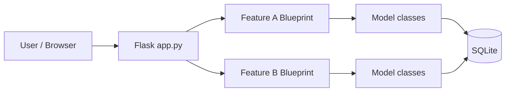
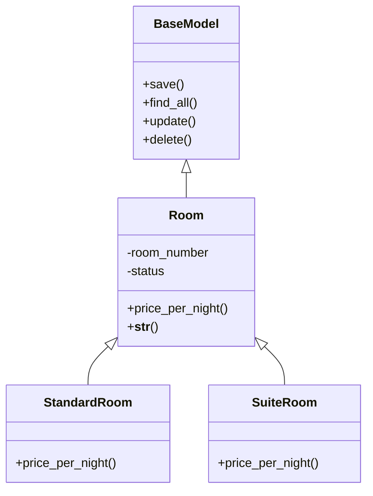
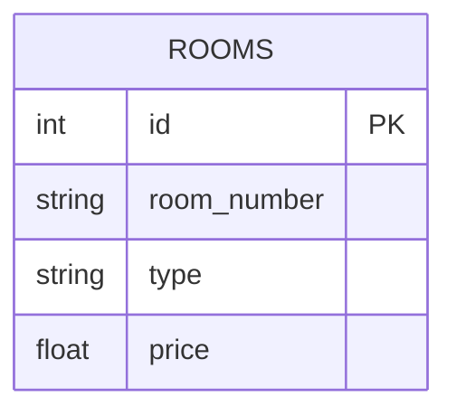

# [Project Name] — Project Scope & System Design

> **192-201 Advanced Computer Programming with Generative AI — Term Project**
>
> **How to use this template**
> - Copy this file into the root of your team repository as `PROJECT_SCOPE.md`.
> - Replace every `[placeholder]` and delete the `<!-- guidance comments -->` when you are done.
> - Sections marked **🟢 REQUIRED** are the *minimum* expectation. Every team must complete them.
> - Sections marked **🔵 OPTIONAL** are extra. You are welcome to go beyond the minimum, but only after the required parts work.
> - Keep it short and clear. Tables and bullet points are better than long paragraphs.

| Item | Detail |
| --- | --- |
| Group number | [e.g. Group 3] |
| Repository link | [https://github.com/...] |
| Version / date | [v1.0 — DD/MM/YYYY] |
| Status | [Draft / Submitted for approval / Approved] |

---

## 1. Project Overview 🟢 REQUIRED

<!-- 1 short paragraph each. A reader who knows nothing about your project should understand it after this section. -->

**1.1 Problem statement**
[What problem exists today? Who has this problem? e.g. "A small dormitory tracks rooms, tenants and payments in paper notebooks, so payments are often missed and rooms double-booked."]

**1.2 Proposed solution**
[What will your system do to solve it? One paragraph.]

**1.3 Target users**

| User role | What they do in the system |
| --- | --- |
| [e.g. Admin / Staff] | [e.g. Manages rooms and tenants] |
| [e.g. Customer / Member] | [e.g. Views their bookings] |

**1.4 Platform**
- [ ] Web (Flask) — **required**
- [ ] Mobile (Flet) — optional extra
- Database: SQLite (required) / MySQL (optional)

---

## 2. Team Members 🟢 REQUIRED

<!-- Every member owns exactly ONE feature. Mark the team lead. -->

| # | Name | Student ID | GitHub username | Role | Feature owned |
| --- | --- | --- | --- | --- | --- |
| 1 | [Name] | [ID] | [@username] | **Team Lead** + Developer | [Feature A] |
| 2 | [Name] | [ID] | [@username] | Developer | [Feature B] |
| 3 | [Name] | [ID] | [@username] | Developer | [Feature C] |
| 4 | [Name] | [ID] | [@username] | Developer | [Feature D] |
| 5 | [Name] | [ID] | [@username] | Developer | [Feature E] |
| 6 | [Name] | [ID] | [@username] | Developer | [Feature F] |
| 7 | [Name] | [ID] | [@username] | Developer | [Feature G] |

**Team lead responsibilities:** communicate with members and report each member's progress to the lecturer. The team lead does **not** do other members' work and does **not** need to force anyone to participate. If someone is not on track, report it.

---

## 3. Project Scope 🟢 REQUIRED

**3.1 In scope:** what the system *will* do
- [e.g. Manage rooms (add, view, edit, delete)]
- [e.g. Record monthly payments and calculate late fees]
- [...]

**3.2 Out of scope:** what the system will *not* do (be honest)
- [e.g. Real online payment]
- [e.g. Email or SMS notifications]
- [...]

**3.3 Assumptions and constraints**
- Only **fake / sample data** is used. No real personal data is sent to AI tools.
- [e.g. Single location only, one admin account]

---

## 4. Features 🟢 REQUIRED

### 4.1 Feature summary

<!-- One row per member. Features must be similar in size. The lecturer may ask you to rebalance. -->

| Feature | Owner | Main class(es) | Table(s) it owns | Business rule (beyond CRUD) |
| --- | --- | --- | --- | --- |
| [Room Management] | [Name] | [Room → StandardRoom, SuiteRoom] | [rooms] | [Price per night depends on room type] |
| [Feature B] | [Name] | [...] | [...] | [...] |
| [...] | | | | |

### 4.2 Feature details

<!-- Copy this block once for EACH feature. -->

#### Feature: [Feature name] — Owner: [Name]

**Description:** [1–2 sentences: what this feature does and who uses it.]

**Minimum checklist (Feature Contract):** every feature must tick all of these.

- [ ] **OOP (CLO1):** entity class inherits from `BaseModel`; encapsulation with `@property` validation; readable `__str__`
- [ ] **Inheritance + polymorphism (CLO1):** at least one parent → child hierarchy with an overridden method used polymorphically
- [ ] **CRUD (CLO2):** Create, Read, Update, Delete via class methods (`save()`, `find_all()`, `update()`, `delete()`), parameterised SQL only
- [ ] **Web pages (CLO3):** list page with search/filter, create form, edit form, delete with confirmation, success/error messages
- [ ] **Business rule:** one rule beyond plain CRUD (calculation, status workflow, or conflict check)
- [ ] **Validation:** bad input shows a friendly message and never crashes the app
- [ ] **Testing (CLO4):** at least 8 pytest tests (CRUD + validation + business rule) using a temporary test database
- [ ] **AI log (CLO5):** `PROMPT_LOG.md` in the feature folder

**Business rule:** [Describe it precisely, e.g. "A booking cannot overlap an existing booking for the same room."]

**Independence check:** [One sentence: how this feature works even if every other feature is missing. e.g. "Payment stores `tenant_name` as text, so it does not require the Tenant feature."]

**Optional extras planned (🔵):** [e.g. Flet mobile screen, CSV export, chart, or "none"]

---

## 5. System Design 🟢 REQUIRED

### 5.1 Architecture

<!-- Use the provided starter structure. Each feature is a Flask Blueprint inside its own folder. Do not edit shared files. -->

```
project/
  app.py                  ← provided (auto-registers every feature)
  core/db.py              ← provided
  core/base_model.py      ← provided
  templates/base.html     ← provided
  features/
    [feature_a]/          ← owner: [Name]
      models.py  routes.py  templates/  tests/  seed.py  PROMPT_LOG.md
    [feature_b]/          ← owner: [Name]
    ...
```



### 5.2 Class diagram

<!-- Show at least: BaseModel, every entity class, and each feature's inheritance hierarchy. Mermaid renders directly on GitHub. -->



### 5.3 Database design

<!-- List every table. Each table belongs to exactly one feature/owner. -->

| Table | Owner | Columns (name : type) | Primary key | Notes |
| --- | --- | --- | --- | --- |
| [rooms] | [Name] | [id : INTEGER, room_number : TEXT, type : TEXT, price : REAL, status : TEXT] | id | [status = available / occupied] |
| [...] | | | | |

**ER diagram (🔵 OPTIONAL but recommended):**



### 5.4 Main pages / screens

| Page | URL route | Feature | Purpose |
| --- | --- | --- | --- |
| [Room list] | [/rooms] | [Room Management] | [List + search rooms] |
| [...] | | | |

---

## 6. Generative AI Usage Plan 🟢 REQUIRED

| Item | Plan |
| --- | --- |
| AI tool(s) used | [e.g. Google Gemini, Groq] |
| What AI will help with | [e.g. draft schema, generate CRUD boilerplate, draft tests] |
| How you verify AI output | [e.g. run pytest, check data in DB Browser, read and explain every line] |
| Data rule | Only fake data is used. No real personal or institutional data goes to AI tools. |

> Every member must be able to **explain their own code** in the defence, including any code the AI wrote.

---

## 7. Timeline 🟢 REQUIRED

| Week | Milestone | Done? |
| --- | --- | --- |
| 11 | Proposal (this document) submitted for approval | [ ] |
| 12 | Each feature: classes + database CRUD working | [ ] |
| 13 | Each feature: web pages + business rule + tests | [ ] |
| 14 | Integration, debugging, code freeze | [ ] |
| 15 | Demonstration and code defence | [ ] |

---

## 8. Optional Enhancements 🔵 OPTIONAL

<!-- Only after all required parts work. List who is doing what. -->

| Enhancement | Owner | Description |
| --- | --- | --- |
| [Flet mobile screen] | [Name] | [...] |
| [Login / authentication] | [Name] | [...] |
| [Dashboard / chart / CSV export] | [Name] | [...] |

---

## 9. Risks 🔵 OPTIONAL

| Risk | Impact | How we handle it |
| --- | --- | --- |
| [e.g. A member falls behind] | [Their feature is late] | [Team lead reports to lecturer; other features still run independently] |

---

## 10. Approval

| | Name | Date | Signature / Comment |
| --- | --- | --- | --- |
| Team Lead | [Name] | [Date] | |
| Lecturer | | | ☐ Approved ☐ Revise and resubmit |
