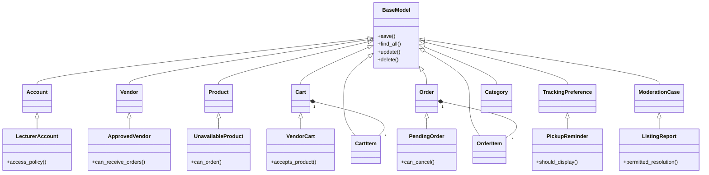

# University Canteen Food & Beverage Marketplace System — Project Scope & System Design

**192-201 Advanced Computer Programming with Generative AI · Term project**

| Item | Detail |
| --- | --- |
| Group number | Awaiting team confirmation |
| Repository link | Awaiting team repository URL |
| Version / date | v1.2 · 8 November 2026 |
| Status | Draft for lecturer review |

## 1. Project overview

**1.1 Problem.** At a busy campus counter, customers must stand in line to place an order and often remain nearby to hear when it is ready. Sellers need a way to distinguish incoming requests from meals they have agreed to prepare.

**1.2 Solution.** A shared local website lets a customer submit a batch to one vendor, track its status and collect it using a vendor-specific queue token. Confirmation commits the seller to preparing the meal and closes the customer’s cancellation window.

**1.3 Target users and permissions**

| User | Customer privileges | Additional authority |
| --- | --- | --- |
| Guest / general customer | Browse menus, use one active cart, place and track own orders, cancel while pending, and see recent history. Students, staff and visitors use this same customer role. | Guests use their browser session. A signed-in general customer can also manage their profile. |
| Lecturer / teacher | Same shopping and pickup rules as a general customer. | Proposed faculty privilege: open a printable order summary for their own department or class meal order. An administrator grants the role after checking a sample faculty roster. |
| Seller | May also shop as a customer. | An approved seller manages only their assigned vendor’s menu, incoming orders and pickup handoffs. |
| Administrator | May also shop as a customer. | Manage accounts, seller approvals, categories, reports and listing moderation. Monitor all orders. |

**1.4 Platform.** Flask web application with Jinja2, Bootstrap and SQLite. Customers and vendors use browsers connected to the local server.

## 2. Team members

Shin Thant Aung (6705140076) is team lead. The lead assigns the seven missions below and reports progress to the lecturer. The team has three backend and four frontend-focused slots. Each owner delivers their feature end to end, including its models and tests. The roster and personal assignments await the lead’s decision.

| Slot | Name / student ID / GitHub | Role | One feature |
| --- | --- | --- | --- |
| 1 | To be assigned | Backend | Accounts and access |
| 2 | To be assigned | Frontend | Vendor directory and seller approval |
| 3 | To be assigned | Frontend | Menu and product listings |
| 4 | To be assigned | Backend | Vendor carts and checkout review |
| 5 | To be assigned | Backend | Order intake and vendor queue |
| 6 | To be assigned | Frontend | Pickup tracking and recent history |
| 7 | To be assigned | Frontend | Marketplace administration |

## 3. Project scope

**3.1 In scope.** Six vendor counters, searchable menus, one active single-vendor cart per customer, guest and account checkout, faculty-role approval and lecturers’ own printable order summaries, seller approval, order tracking, ready reminders, pickup completion, recent history and administrative oversight.

| Queue prefix | Vendor |
| --- | --- |
| A | Burmese Food |
| B | Thai Phat Krapow |
| C | Thai-style Omelette and Rice |
| D | Thai Noodle |
| E | Beverage |
| F | Grilled Chicken Rice |

**3.2 Out of scope.** Payment processing, delivery, SMS, background push notifications, native mobile apps and public internet deployment.

**3.3 Assumptions and constraints.** Use synthetic demonstration data. Students order as general customers. An administrator checks a sample faculty roster before granting lecturer access. Guests keep access through a private browser session. Service dates use Bangkok local time. History shows completed and cancelled orders closed in the last 24 hours. Older entries disappear from the customer history view while records remain available for administration. Open orders stay visible across midnight until resolved.

## 4. Features

### 4.1 Feature summary

| Owner slot | Feature | Entity hierarchy | Tables owned | Overridden operation |
| --- | --- | --- | --- | --- |
| 1 | Accounts and access | Account → LecturerAccount | users | `access_policy()` |
| 2 | Vendor directory and seller approval | Vendor → ApprovedVendor | vendors | `can_receive_orders()` |
| 3 | Menu and product listings | Product → UnavailableProduct | products | `can_order()` |
| 4 | Vendor carts and checkout review | Cart → VendorCart | carts, cart_items | `accepts_product()` |
| 5 | Order intake and vendor queue | Order → PendingOrder | orders, order_items | `can_cancel()` |
| 6 | Pickup tracking and recent history | TrackingPreference → PickupReminder | tracking_preferences | `should_display()` |
| 7 | Marketplace administration | ModerationCase → ListingReport | categories, moderation_cases | `permitted_resolution()` |

### 4.2 Feature contracts

Every owner completes the same eight checks for their feature. The CRUD target in each brief identifies the record used to demonstrate editing and deletion. Submitted order details and queue records are retained.

- [ ] **CLO1, entity design.** Inherit from `BaseModel`, validate an encapsulated field using `@property` and implement a readable `__str__`.
- [ ] **CLO1, polymorphism.** Exercise the overridden operation from 4.1 through its parent interface.
- [ ] **CLO2, CRUD.** Implement `save()`, `find_all()`, `update()` and `delete()` with parameterised SQL.
- [ ] **CLO3, web.** Provide a searchable or filterable list, create and edit forms, confirmed deletion and feedback.
- [ ] **Business rule.** Enforce the feature’s rule on the server.
- [ ] **Validation.** Reject invalid input with a readable error and preserve the previous valid state.
- [ ] **CLO4, tests.** Run at least eight pytest cases per feature using a temporary database. Cover CRUD, invalid input, denied actions and boundary cases.
- [ ] **CLO5, AI log.** Keep the course-required `PROMPT_LOG.md` for each feature. The supplied tree does not yet list these logs. Track their locations in `docs/OWNERSHIP.md`.

#### 1. Accounts and access

**Owner:** slot 1. **CRUD target:** Account profile. An administrator grants lecturer status. Limit printable faculty order summaries to the lecturer’s own orders. Guests use a private session. Test privileged access with synthetic role fixtures. Demonstrate deletion with an unused sample account. Deactivate accounts referenced by orders.

#### 2. Vendor directory and seller approval

**Owner:** slot 2. **CRUD target:** Vendor profile. Only an active vendor with an approved seller can receive orders. Restrict registration to the six configured vendor slots. Use a seeded seller ID for standalone demos. Demonstrate profile removal only on an unused test slot. Preserve vendor identities referenced by orders.

#### 3. Menu and product listings

**Owner:** slot 3. **CRUD target:** Product listing. An unavailable item remains visible with its availability label and cannot be checked out. Only the assigned seller may change its price. Seed one vendor and category. Archive purchased listings so receipts remain readable.

#### 4. Vendor carts and checkout review

**Owner:** slot 4. **CRUD target:** Cart item. The first item binds the customer’s only active cart to one vendor. Reject another vendor’s item and preserve the cart. Checkout releases the cart immediately, even if the resulting order is still pending or preparing. Failed checkout preserves the vendor and its items. Seed two vendors with sample items.

#### 5. Order intake and vendor queue

**Owner:** slot 5. **CRUD target:** Unsubmitted order draft. Accept or cancel a pending order only once. Confirmation allocates a token in the same transaction. Seed pending orders to exercise both outcomes.

#### 6. Pickup tracking and recent history

**Owner:** slot 6. **CRUD target:** Tracking preference. Show the reminder when the order becomes ready. Completion requires seller handoff. Default history uses a rolling 24-hour window. Use a fake order reader and transition service in isolation.

#### 7. Marketplace administration

**Owner:** slot 7. **CRUD target:** Category or moderation case. Only administrators may resolve reports or moderate listings. Prevent removal of a category still in use. Seed a sample report and a product reference.

### Order lifecycle and acceptance checks

| Current state | Who acts and when | Result |
| --- | --- | --- |
| Cart | Customer submits one vendor’s cart | **Pending**. The vendor receives the order. No queue token exists yet. |
| Pending | Owning customer cancels | **Cancelled**. The order closes without a token. |
| Pending | Assigned seller confirms | **Preparing**. The system assigns one token and shows it to both parties. |
| Preparing | Assigned seller finishes preparation | **Ready for Pickup**. The customer’s open tracking page displays a reminder. |
| Ready for Pickup | Assigned seller hands over the food and records collection | **Completed**. The order leaves the active queue and enters history. |

Accept and cancel compete for the same pending row. Use a conditional update inside a transaction. Only the winning action changes the state. On confirmation, allocate the next number for that vendor and service date under the same write transaction, with a unique constraint on vendor, date and number. Repeated confirmation returns the existing token. Failed attempts roll back. Checkout uses a unique submission key to prevent double orders on retry.

| Demonstration | Expected result |
| --- | --- |
| Alice adds noodles, then attempts to add a Beverage Pepsi | Reject Pepsi, keep the noodles and show the checkout instruction. No second cart exists. |
| Noodle checkout fails, then Alice retries successfully | Failure preserves the noodles. Success submits one noodle order and releases the cart. |
| Alice visits Beverage while the noodles are preparing | Alice adds Pepsi again to a fresh cart. Beverage receives its own order only after she checks out. |
| Two tabs simultaneously add first items from different vendors | Only one vendor wins the cart. The other add fails without changing it. |
| General customer opens the faculty summary, or lecturer opens someone else’s summary | Deny both. An approved lecturer can print their own summary. |
| Seller changes price before checkout | Customer must review the updated total before submitting. |
| Confirm and cancel concurrently | Exactly one succeeds. A cancelled order has no token. |
| Open a different customer’s order or manage another seller’s queue | Server denies the request even with a known token. |
| Ready reminder, handoff, then advance clock by 24 hours | Reminder appears on open page. Completed order exits recent history at 24 hours. |
| Leave an order preparing for over 24 hours | Both parties can still see it in active orders. |

## 5. System design

### 5.1 Architecture

The root `app.py` starts the Flask application defined in `app/__init__.py`. Route modules in `app/routes/` call business logic in `app/services/`. Access checks belong in `app/permissions.py`, SQLite access in `app/db.py`, and table definitions in `app/schema.sql`. Runtime data belongs under `instance/`. The complete tree appears in the README and the repository’s `docs/FOLDER_STRUCTURE.txt`.

| Mission | Main implementation paths |
| --- | --- |
| Accounts and access | `routes/auth.py`, `services/accounts.py`, `permissions.py`, `templates/auth/` |
| Vendor directory and seller approval | `routes/main.py`, `routes/seller_profile.py`, `routes/admin_users.py`, `templates/index.html` |
| Menu and product listings | `routes/catalog.py`, `routes/seller_products.py`, `services/catalog.py`, `templates/catalog/` |
| Cart and checkout | `routes/cart.py`, `services/cart.py`, cart and checkout pages in `templates/student/` |
| Order intake and queue | `routes/orders.py`, `routes/seller_orders.py`, `services/orders.py`, `templates/seller/orders.html` |
| Pickup tracking and history | Order routes and service shared with the queue owner, `templates/student/order_detail.html`, `templates/student/orders.html`, `templates/seller/pickup.html` |
| Marketplace administration | `routes/admin_users.py`, `routes/admin_catalog.py`, `routes/admin_orders.py`, `templates/admin/` |

Paths in the table are relative to `app/`. Coordinate shared-module changes through `docs/OWNERSHIP.md` and `docs/CONTRACTS.md`. The existing student-named templates serve all customer types. The proposed entity classes in section 5.2 can live in the corresponding service modules. The shared base class is a course design requirement whose location is still to be decided.

Tests live in root `tests/` with shared fixtures in `conftest.py`. Use `test_foundation.py`, `test_auth.py`, `test_catalog.py` and `test_orders.py` for the relevant scenarios, and use `docs/TEST_PLAN.md` to track coverage by owner. The two QR modules and `test_qr.py` appear in the supplied tree but are outside the pickup workflow.

| Integration | Responsibility |
| --- | --- |
| Menu → cart | Supply product ID, vendor, availability and current price. |
| Cart → order | Validate and snapshot items, create the pending order and delete the active cart and its items in one transaction. |
| Order → pickup | Expose authorised status reads and seller-only transitions. Pickup calls the order service for changes. |
| Admin → accounts, vendors and menu | Invoke the owning feature’s approval or moderation operation. Keep one writer for each rule. |

### 5.2 Class diagram

### 5.3 Database design

All primary keys below are integer IDs. Store money as integer satang and timestamps in UTC. Convert to Bangkok time for display and service dates.

| Table | Owner | Columns in addition to primary key | Constraint or purpose |
| --- | --- | --- | --- |
| users | Accounts | email TEXT, password_hash TEXT, role TEXT, active INTEGER | Unique email. Admin grants lecturer role. Store password hashes. |
| vendors | Vendors | name TEXT, prefix TEXT, seller_id INTEGER, approval TEXT | Unique prefix and seller assignment. Seller references users. |
| products | Menu | vendor_id INTEGER, category_id INTEGER, name TEXT, description TEXT, photo_path TEXT, price_satang INTEGER, available INTEGER | Foreign keys to vendors and categories. Price ≥ 0. |
| carts | Carts | owner_key TEXT, vendor_id INTEGER | UNIQUE(owner_key) across all active carts. Bind vendor on first add in a transaction. Owner key derived from account or private guest session. |
| cart_items | Carts | cart_id INTEGER, product_id INTEGER, quantity INTEGER | Unique cart and product pair. Positive quantity, matching vendor. |
| orders | Orders | owner_key TEXT, vendor_id INTEGER, submission_key TEXT, is_draft INTEGER, status TEXT, service_date TEXT, queue_no INTEGER, total_satang INTEGER, created_at TEXT, closed_at TEXT | Unique submission key and unique confirmed queue position. Drafts have no public status. |
| order_items | Orders | order_id INTEGER, product_id INTEGER, item_name TEXT, unit_satang INTEGER, quantity INTEGER | Snapshot names, prices and quantities at checkout. |
| tracking_preferences | Pickup | owner_key TEXT, label TEXT, vendor_id INTEGER | Optional saved tracking filters. Ready reminders are enabled on the active order page regardless. |
| categories | Admin | name TEXT | Unique category name. |
| moderation_cases | Admin | product_id INTEGER, reason TEXT, state TEXT, resolved_by INTEGER | Link report to listing and resolving administrator. |

### 5.4 Main pages and screens

| Page | Proposed route | Feature | Purpose |
| --- | --- | --- | --- |
| Campus directory | `/` | Vendors | Browse all six counters |
| Register, sign in, profile | `/register`, `/login`, `/account` | Accounts | Manage identity and account |
| Vendor menu / item | `/vendors/<id>/menu`, `/products/<id>` | Menu | Search, filter and inspect food |
| Menu editor | `/seller/products` | Menu | Maintain prices and availability |
| Vendor cart / review | `/carts/<vendor_id>`, `/carts/<vendor_id>/checkout` | Carts | Edit quantities and confirm total |
| Seller queue | `/seller/orders` | Orders | Confirm, prepare, mark ready and record collection |
| Track order / recent history | `/orders/<id>`, `/history` | Pickup | See status, cancel pending orders, review closed orders |
| Seller approval | `/admin/vendors` | Vendors | Review vendor applications |
| Faculty order summary | `/orders/<id>/faculty-summary` | Accounts / Pickup | Print the owning lecturer’s order details and total; this is not proof of payment |
| Administration | `/admin` | Admin | Manage accounts, categories, moderation and order oversight |

## 6. Generative AI usage plan

| Item | Plan |
| --- | --- |
| Tools and uses | ChatGPT for design review, test ideas and explanations. Each member records the prompts actually used. |
| Verification | Explain each class, run its tests, inspect the temporary database and demonstrate allowed and denied actions. |
| Data rule | Use fake records in prompts. Keep real user records, credentials and institutional data out of prompts. |
| Defence | Every member explains and demonstrates their own code, including AI-assisted portions. |

## 7. Timeline

| Week | Milestone | Done? |
| --- | --- | --- |
| 11 | Agree on rules, assign owners, submit scope for review | Open |
| 12 | Demonstrate each feature’s classes and SQLite CRUD independently | Open |
| 13 | Finish pages, validation, business rules and at least 56 feature tests across the team | Open |
| 14 | Integrate and rehearse sequential checkout at two vendors, cancellation, concurrent confirmation and pickup | Open |
| 15 | Demonstrate on the LAN and defend each feature | Open |

## 8. Optional enhancements

| Enhancement | Proposed owner | Acceptance condition |
| --- | --- | --- |
| Closed-browser pickup alerts | Pickup owner | Future phase, after the open-page reminder works reliably. |

## 9. Risks

| Risk | Impact | Response |
| --- | --- | --- |
| Two sellers confirm simultaneously | Duplicate tokens | Transaction and uniqueness constraint. Test with two database connections. |
| Guest clears session | Loses private tracking access | Explain same-browser tracking at checkout and offer account sign-in before ordering. |
| Counter staff forget completion | Active queue becomes stale | Keep ready orders visible until the seller records handoff. |
| Campus Wi-Fi blocks host access | Phones cannot order | Test on two devices before the demo and arrange a permitted shared LAN. |
| Owner falls behind | Integration stalls | Seed each feature independently and report blockers to the lecturer. |

## 10. Approval

| Role | Name | Date | Signature / comment |
| --- | --- | --- | --- |
| Team lead | Shin Thant Aung | Pending sign-off | Draft for review |
| Lecturer | Awaiting review | Pending | Decision pending |

